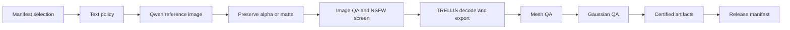

# relief-atlas

<p align="center">
  <picture>
    <source media="(prefers-color-scheme: dark)" srcset="assets/logo-dark.svg">
    <source media="(prefers-color-scheme: light)" srcset="assets/logo-light.svg">
    
  </picture>
</p>

**A manifest-driven pipeline for disaster relief and civil-protection 3D assets.**

Generate reference images, textured GLB meshes and Gaussian containers for
visual simulation, research and planning. The local backend runs
Qwen-Image-2.1 → TRELLIS.2 on Apple Silicon; a separate cloud backend uses paid
fal.ai and Runware APIs.

The four relief manifests define **10,079 planned items**. Under the current
text policy, **9,509 are eligible by default**, 540 are restricted and 30 are
blocked. These counts describe input coverage, not a completed or certified
release. Generated binaries and model weights are not included in a git clone.

**Using the prepared Mac offline:** go straight to
[Start, pause and resume offline](#start-pause-and-resume-offline). The four
double-click controls use the installed runtimes and cached models; fresh setup
and cloud commands later in this README are separate workflows.

| Geography | Manifest rows | Coverage |
| --- | ---: | --- |
| Germany | 4,079 | DRK, THW, Feuerwehr, Bundespolizei, Bundeswehr |
| EU | 2,500 | Civil Protection, Red Cross, member states |
| Ukraine | 2,500 | Humanitarian response, recovery, rebuilding |
| General | 1,000 | Global disaster response |

## Start without generating anything

From the repository root, these commands need only Python's standard library:

```bash
# Inspect a representative selection without setup or inference
python3 scripts/local/run_all.py --dry-run --ids gen_dis_0001 ger_uav_0001 gen_med_0001 eu_rc_0001

# Inspect policy classifications
python3 scripts/local/content_policy.py --list blocked
python3 scripts/local/content_policy.py --list restricted

# Count work using current artifact-bound certification
python3 scripts/local/pending.py --certified --json

# Inspect release eligibility without writing a release manifest
python3 scripts/local/release_manifest.py --dry-run
```

A fresh checkout has no local assets or QA ledgers, so pending work is expected.
A dry-run release command can succeed with zero included assets; read its counts.

## What the local pipeline does



Every generation and QA stage receives the same selection. Failed samples retry
with a changed seed; after three rejections an item is quarantined. Renderer or
runtime failures stop the run. The release command separately derives which
artifacts are eligible to distribute.

| Role | Model or component | Execution |
| --- | --- | --- |
| Reference image | Qwen-Image-2.1 | Pinned Diffusers implementation, PyTorch MPS |
| Opaque-image matting | BiRefNet with chroma fallback | CPU; native Qwen alpha is preserved |
| Image-to-3D | TRELLIS.2-4B via the pinned trellis-mac port | MPS and Metal texture bake |
| Image conditioning | DINOv3 ViT-L/16 | Required trained checkpoint; MPS |
| Sparse structure decoder | TRELLIS-image-large `ss_dec_conv3d_16l8_fp16` | MPS |
| Image safety classification | Falconsai/nsfw_image_detection | CPU; required for certified image QA |
| Compressed Gaussian container | Niantic SPZ binding | Optional; SPLAT fallback |

Exact revisions, required files and checkpoint hashes are in
[config/local_models.json](config/local_models.json). Runtime source pins are in
[config/local_runtime.json](config/local_runtime.json) and
[requirements-image.txt](requirements-image.txt) /
[requirements-mesh.txt](requirements-mesh.txt). The configured image identity is
`local/qwen-image-2.1`; historical outputs from other models retain their recorded
provenance. Measure quality, timing and memory use with an isolated pilot on
the target machine before planning a larger run.

## Reference prompt recipes

Generation manifests store a versioned reference recipe with explicit subject,
geometry, surface condition, viewpoint, capture and background instructions.
The compiler is [generation_prompts.py](scripts/local/generation_prompts.py),
with item specifications in [prompt_specs.py](scripts/local/prompt_specs.py) and
conservative type constraints in [shape_specs.py](scripts/local/shape_specs.py).
It uses the primary asset noun rather than incidental cargo to choose geometry
constraints. Authored rotor counts, motor axes and hub alignment are explicit;
coaxial rotors and helicopter tail rotors keep their different arrangements.
Tent designs, requested poses, dimensions, material colours and emblems remain
part of the subject instead of being replaced by arbitrary category variants.

Recipes distinguish standalone parts, complete machines and explicit sets.
A brushless drone motor is one component; a five-aircraft swarm remains five
complete aircraft. Rotor count alone does not determine arm count: the
[DJI FlyCart 30](https://www.dji.com/media-center/announcements/dji-launch-fly-cart-30)
uses four coaxial pairs. The generic cargo octocopter instead records an explicit
eight-boom design choice using the Freefly ALTA8 manual as a layout example.
The local [reference library](config/reference_library.json) records primary
sources, their limited applicability and whether a visual example was inspected.
Each cited recipe binds those records by hash. A family example is not an exact
product verification; authored primitive dimensions are not web research.

The original text is retained in each row's `generation_prompt.sources`, with
its hashes. Policy screens the original and rewritten wording and retains the
more restrictive result. Rewriting does not change IDs, selection, physics
metadata or historical generated outputs. Local Qwen prompts use the native
RGBA format from the [official model card](https://huggingface.co/Qwen/Qwen-Image-2.1#transparent-image-generation-rgba);
cloud prompt helpers use the same recipe with a neutral background.

```bash
# Audit all source generation manifests; no model loading or API calls
python3 scripts/rewrite_generation_prompts.py --report state/prompt_audit.json --review-guide state/prompt_review.json
# Write checked recipes while retaining original source text
python3 scripts/rewrite_generation_prompts.py --apply --report state/prompt_rewrite.json
```

The rewrite checks identity preservation, policy eligibility, source hashes,
distinct default-eligible active prompts and idempotence before writing.
`generate_prompts.py` emits the same recipes for future catalogue generation and
preserves integrated `legacy_` rows in an existing destination manifest.
Existing images, meshes and queued snapshots retain their recorded prompts.
Use isolated output/state directories to compare a new recipe. Prompt constraints
guide generation; numerical QA does not verify motor count or mechanical alignment.
The review guide lists every distinct visual definition, its evidence, the
affected manifest rows and observable review checks. Its approval fields start
false; source coverage is reported separately from generated-result review.
See [prompt design and review](docs/prompt-design.md) before adding references
or changing a type rule.

For the generic cargo octocopter, text-only references can still omit a motor.
An optional local structure guide fixes eight illustrative boom and hub positions
before native Qwen editing. It currently supports only the recipe's explicit
flat eight-boom cargo layout:

```bash
meshmaker/local/trellis-mac/.venv/bin/python scripts/local/build_structure_guide.py \
  --id ger_uav_0001 --output state/drone_guide/layout.png
RELIEF_OUTPUT_DIR="$PWD/state/drone_guided/outputs" \
RELIEF_STATE_DIR="$PWD/state/drone_guided/state" \
meshmaker/local/imgenv/bin/python scripts/local/qwen_imagegen.py \
  --ids ger_uav_0001 --structure-reference state/drone_guide/layout.png --size 1024
```

The builder writes a transparent PNG, an illustrative GLB and a hash-bound JSON
sidecar. These are authored guide artifacts, not a generated deliverable or a
metric product model. Qwen records the native edit and actual guide hashes.
Inspect the generated reference before reconstruction: image conditioning does
not guarantee that every motor survives generation. This mode and
`--reframe-reference` are mutually exclusive; both require one explicit ID and
preserve their source.

## Start, pause and resume offline

### Everyday controls

On this prepared Mac, disconnecting the internet does not interrupt local
generation. Double-click these files in the repository folder:

| File | Action |
| --- | --- |
| [Start.command](Start.command) | Start the saved run, or freeze the configured collection on the first start |
| [Pause.command](Pause.command) | Stop active work and save the paused state |
| [Resume.command](Resume.command) | Continue using verified work already on disk |
| [Status.command](Status.command) | Show progress and the current stage without starting anything |

No environment activation or open terminal is needed. Start registers a user
login service; a running job resumes after reboot **when you log in**. A manual
pause stays paused across logins. Closing the terminal does not stop the job.
The worker runs inside a macOS network-denying sandbox, with the Hugging Face
offline flags enabled. It never installs packages, downloads weights or calls
the paid backend. Missing prerequisites stop with a saved explanation.

Use **Start** for the first run and **Resume** after a pause. Repeated clicks are
safe. Resume before the first Start also prepares the default run. Status never
starts or resumes work. A new run begins only when you use Start/Resume yourself.
For continuous work, keep the Mac on power with its lid open. Idle sleep is
inhibited while working; lid closure, forced sleep and shutdown can suspend or
interrupt GPU work. After waking, use Status; Resume rechecks interrupted work.

### Selection and settings

The first Start uses [config/offline_run.json](config/offline_run.json): all
currently default-policy eligible active items, 40-step 1024 references, 512
geometry, 2048 textures and compact SPZ output with the existing SPLAT fallback.
The tested radial cargo-octocopter recipe uses its authored structure guide and
`1024_cascade`; other aircraft keep their own recipe. Selection and settings are
saved under `state/offline_controller/runs/`. Resume uses that saved selection
even if the live catalogue or configuration changes later.

Finished artifacts are revalidated against their hashes and current QA. A pause
during sampling restarts that unfinished stage on resume; it does not save the
model's in-memory denoising steps. Committed references and completed deliverables
are reused. The controller waits for charging at low battery, checks the disk
reserve before starting an item, prevents duplicate managed workers, serializes
local model CLI processes and bounds retries. Quarantined or repeatedly failing items
remain visibly incomplete; completion requires positive release membership for
every selected item. Automatic QA remains distinct from visual and physics review.

| Offline default | Value and behavior |
| --- | --- |
| Selection | All default-policy eligible active rows, frozen on first Start |
| Image model | Configured Qwen-Image-2.1; 40 steps, guidance 1.0, 1024 reference |
| Geometry | TRELLIS.2, 512 preset, 2048 textures, 200,000 target faces; native sampler defaults |
| Guided cargo octocopter | Authored eight-boom guide with `1024_cascade` geometry; existing valid references are reused |
| Gaussian format | SPZ, falling back to SPLAT when the SPZ binding is unavailable |
| Low battery | Stop sampling at 15% or below on battery; wait for AC power or more than 25% charge |
| Disk reserve | Wait below 12 GB free before starting an item; this is working reserve, not the complete collection budget |
| Controller retries | Up to 3 attempts per incomplete item, with a 60-second delay; QA has its own bounded content retry budget |

Each distinct geometry/texture/container preset is checked before its first
pending item. Battery waiting survives worker restart and a manual pause. Power,
disk space and pipeline ownership are checked again while waiting for the GPU.

Defaults in [config/offline_run.json](config/offline_run.json) apply to a **new**
run. Editing them does not alter an existing saved run. To change its selection
or settings deliberately, pause, then use `./atlas start --new-run` with the
desired options. Old plans and generated files remain. A settings change alone
does not regenerate already certified assets; choose a separate output/state
pair for a new comparison.

### Recovery after an interruption

**You can pause between any stages, including after an image exists but before
its GLB exists.** Resume inspects the files and their commit metadata, rather than
trusting the last progress message:

| What was saved before interruption | What Resume does |
| --- | --- |
| Nothing, only a raw frame, or hidden temporary files | Generate the unfinished reference; temporary files do not count as completed work |
| PNG without matching `image_meta.json` | Regenerate the uncommitted reference; native edits require their matching saved edit intent |
| Committed PNG, with no GLB | Keep the image, finish image QA if needed, then generate the 3D deliverable |
| GLB without a Gaussian container, or geometry without `metadata.json` | Keep the committed image and regenerate the incomplete 3D stage, including GLB and Gaussians |
| Complete geometry, with missing or outdated QA | Reuse the geometry and run the required QA; rejected content follows bounded regeneration and quarantine |
| Geometry bound to an older PNG | Keep the current committed reference and regenerate geometry from it |
| All stages certified, but release accounting interrupted | Recheck certification and write the release manifest without loading either generator |

After a crash or sudden power loss, the login service performs the same recovery.
A pause request is saved before stopping the worker; repeated Start/Resume clicks
keep the saved selection and do not launch a second worker. Completed earlier
items are kept when a later item is interrupted.

By default, assets are saved to
`outputs_relief/<geography>/<category>/<id>/`; controller state and logs live in
`state/offline_controller/`, with QA ledgers in `state/qa_*.json`. Keep those
directories in place. Scanning their hashes can take time; Status reports that
scan separately from generation.

Keep the repository at the same path on this Mac. Saved plans, the login service
and virtual environments use absolute paths. Preserve `meshmaker/local/`, its
models and upstream source, the managed Python installations used by those
environments, and your output/state directories. Keep any referenced drives
mounted. A git clone alone omits these prepared files and cannot replace them
while offline.

### Terminal commands and a smaller saved run

The same controls work from a terminal in the repository root:

```bash
./atlas start
./atlas pause
./atlas resume
./atlas status
./atlas logs
./atlas plan                 # preview; no inference or service installation
```

These commands run from the repository root. Finder controls locate it
automatically. Start/Resume return after launching the background service;
Status reports actual progress. Pause first persists the request and waits for
owned child processes to exit. If a slow shutdown is still in progress, check
Status again; a later Resume supersedes the pause.

For a deliberately bounded run, use a separate output and QA-state pair:

```bash
# Preview this selection without creating a run or launching models
./atlas plan --ids gen_dis_0001 ger_uav_0001 gen_med_0001 eu_rc_0001

# First run; if a saved run already exists, pause and add --new-run to this command
./atlas start --ids gen_dis_0001 ger_uav_0001 gen_med_0001 eu_rc_0001 \
  --output-dir outputs_offline_pilot --state-dir state/offline_pilot
```

The four Finder controls now operate on that saved pilot until you intentionally
create a new run. Returning to the whole default collection requires pausing and
using `./atlas start --new-run`. No outputs are moved between pilot and production
directories automatically.

For an advanced separate controller, put `--control-dir /absolute/path` before
the action on **every** command. Finder controls always use the default
`state/offline_controller/`; they do not control a different custom controller.

### Readiness check with network access denied

Start performs its own preflight. To check the cached models, imports, MPS
allocation and a small run's disk budget yourself, this command works offline
and does no image or 3D sampling:

```bash
/usr/bin/sandbox-exec -p '(version 1)(allow default)(deny network*)' \
  meshmaker/local/imgenv/bin/python scripts/local/preflight.py --phase all \
  --ids gen_dis_0001 ger_uav_0001 gen_med_0001 eu_rc_0001 --texture-size 2048
```

To check the guided geometry preset:

```bash
/usr/bin/sandbox-exec -p '(version 1)(allow default)(deny network*)' \
  meshmaker/local/imgenv/bin/python scripts/local/preflight.py --phase all \
  --ids ger_uav_0001 --pipeline-type 1024_cascade --texture-size 2048
```

The checks use local files and existing Python environments. They neither
download models nor install the login service. A ready preflight establishes
local prerequisites; generation and QA still run for each pending item.

Hugging Face login, API credits and internet access are unnecessary for cached
local generation. Missing or damaged models need a healthy local backup or
preparation while online; Resume does not fetch replacements. Avoid running
`setup_local.sh`, package upgrades or the preparation/download commands below
during ordinary offline operation.

### Status and troubleshooting offline

| Status | Meaning and next action |
| --- | --- |
| Not started | Use Start when you want to begin |
| Scanning / verifying | Saved artifact hashes and QA are being checked; allow the scan to finish |
| Preflight / structure guide / generating | Work is active; the current item and generator/QA phase appear in Status |
| Item checked / release | Advancing between items or deriving the final release membership |
| Paused | Your pause is saved; use Resume when ready |
| Waiting for power | Connect power or let charge exceed the saved recovery threshold; manual Pause still takes precedence |
| Waiting for disk | Make space available on the saved output volume; the worker rechecks automatically |
| Waiting for GPU / pipeline | Another local job owns the lease; let it finish or pause it normally |
| Retry wait | A bounded attempt failed; read the logs or allow the next attempt |
| Recovering / interrupted | The supervisor is restarting or reconciling the saved run; if it persists, use Resume and inspect logs |
| Needs attention | A prerequisite, repeated failure, changed snapshot or quarantine needs review; see the saved error and logs |
| Completed | Every saved target has current required QA and is included in the saved release manifest |

If Status reports **needs attention**, read `./atlas logs` and the saved error.
After correcting a local runtime or storage problem, use Resume to recheck and
continue. QA quarantine is retained for review. The controller reports completion
only when every selected item passes all required gates and belongs to the release.

`./atlas logs` prints recent stage **and supervisor** logs, including startup
failures before the first stage. The full files remain at:

| Path | Purpose |
| --- | --- |
| `state/offline_controller/control.json` | Latest intent and committed run ID |
| `state/offline_controller/status.json`, `state/offline_controller/phase.json` | Counts, heartbeat, current item/stage and error |
| `state/offline_controller/supervisor.log` | Background-service startup output |
| `state/offline_controller/runs/<run-id>/plan.json` | Saved selection and absolute output/state paths |
| `state/offline_controller/runs/<run-id>/manifests/` | Hash-bound selected manifest snapshots |
| `state/offline_controller/runs/<run-id>/run.log` | Full stage output |
| `state/offline_controller/runs/<run-id>/progress.json` | Controller retry state |
| `state/offline_controller/runs/<run-id>/guides/` | Cached authored geometry guides and their provenance |
| `state/offline_controller/runs/<run-id>/release_manifest.json` | Final included artifacts and their hashes |
| `<saved-state-dir>/preflight.json` | Latest worker prerequisite check |
| `<saved-state-dir>/qa_{images,meshes,gaussians}.json` | The three current artifact-bound QA ledgers |
| `<saved-state-dir>/qa_quarantine.json` | Items requiring content review |

Changing filenames or deleting lock files does not repair a run. The OS releases
process locks after termination, even when their PID files remain. Keep snapshots,
commit metadata, quarantine and QA ledgers intact. Restore damaged saved state
from a known backup; the controller stops on unreadable or changed state rather
than guessing that work passed. A missing renderer or safety detector requires
restoring the prepared runtime; bypassing QA does not produce a complete release.

To remove automatic login recovery, use `./atlas uninstall`. It pauses and
removes this controller's service while preserving plans, assets and QA. The
next Start/Resume registers the service again. The earlier model-preparation
service described below is separate from these generation controls.

See [offline operation and recovery](docs/offline-run.md) for saved paths,
small custom runs, configuration and removing the login service.

## Prepare a fresh Apple Silicon machine

The local backend targets macOS on Apple Silicon and was developed on an M4 Max
with 128 GB unified memory. That machine is a development reference, not a
verified minimum hardware requirement. Setup requires `python3`, `uv`, `git`,
and build tools for upstream Metal/native extensions. It builds separate Python
3.12 image and Python 3.11 mesh environments.

Request access to the configured DINOv3 repository through its model card, then
authenticate with an approved Hugging Face account. Follow the model's access
and license terms. Qwen is fetched from its pinned public repository.

```bash
# DINOv3 model card: https://huggingface.co/facebook/dinov3-vitl16-pretrain-lvd1689m
uvx --from huggingface-hub hf auth login

# Downloads packages, upstream source and model weights; builds native extensions
bash scripts/local/setup_local.sh
```

Setup reuses healthy environments and validates missing or existing model
bundles. When `aria2c` is available, large Qwen and DINO checkpoints use the
resumable transfer path. That path uses **one file and one connection at a time,
256 KiB/s**, saving resume maps every ten seconds and retrying slowly. Without
aria2, setup uses the standard Hugging Face downloader; it does not provide the
same explicit rate cap. Package installation and git cloning also have their
own network behavior. On a connection with administrator restrictions, install
aria2 and inspect the setup steps before launching a fresh bootstrap.

Prepared generation and QA use local files with offline loading. Preparing or
refreshing missing models and running cloud generation can require network
access. Existing-model validation and local SPZ colour repair work offline.
Model integrity validation does not by itself prove that full inference will work.

## Run a bounded pilot first

Use separate output and state directories to keep pilot artifacts and ledgers
out of a production run. Run these commands in the same shell:

```bash
export RELIEF_OUTPUT_DIR="$PWD/outputs_pilot"
export RELIEF_STATE_DIR="$PWD/state/pilot_manual"

# Check model files, imports, actual MPS allocation, selection and disk capacity
python3 scripts/local/run_all.py --preflight-only --ids gen_dis_0001 ger_uav_0001 gen_med_0001 eu_rc_0001

# Rubble, drone, medical tent and vehicle
python3 scripts/local/run_all.py --batch-size 4 --ids gen_dis_0001 ger_uav_0001 gen_med_0001 eu_rc_0001

python3 scripts/local/verify_local.py
python3 scripts/local/release_manifest.py --dry-run
```

Review the references and mesh/Gaussian turntable montages. Check shapes,
materials, disconnected parts and thin structures; numerical gates do not
replace human review. The isolated release report scans all manifests, so items
outside this four-item pilot appear as missing/excluded.

The QA mesh sheets show low-resolution silhouettes and depth cues. For a visual
quality decision, also render the complete exported GLB with its base-color
texture and a depth buffer (uses `moderngl` in the mesh environment):

```bash
meshmaker/local/trellis-mac/.venv/bin/python scripts/local/review_assets.py \
  "$RELIEF_OUTPUT_DIR/eu/red_cross_eu/eu_rc_0001/eu_rc_0001.glb" \
  --output "$RELIEF_STATE_DIR/visual_review"
```

This writes ten-view textured and clay sheets plus the hashes of the reviewed
GLBs. These diffuse-light previews do not simulate all metallic/roughness PBR
effects and do not issue QA passes. Compare them with the reference and inspect
hidden sides, markings, thin parts and surface noise before accepting quality.

Defaults are 40 Qwen steps, guidance 1.0, a 1024-pixel reference, 512 geometry,
1024 textures and SPZ export. Higher geometry settings are `1024` and
`1024_cascade`; textures can be 512, 1024 or 2048. `--mesh-steps 16` overrides the
structure, shape and texture samplers together; omitting it uses the pinned
model's settings. `--target-faces` controls the triangle target before baking
(default 200,000). Effective sampler parameters and the face target are recorded
in new geometry metadata. More detail costs memory and time and requires visual
comparison; a higher setting is not itself evidence of better output. Batch size
bounds the item selection per pass; it does not imply parallel GPU inference.

Each geometry configuration requires its own pilot on the target runtime.
Resource and transport errors stop generation and preserve its failure ledger
and completed assets; resampling content cannot repair an allocation failure.

For a useful reference whose outer parts were cropped, the image generator also
supports Qwen's native reference editing. Reframe into a separate output tree;
the source PNG and its matching Qwen metadata are required and remain intact.
This operation accepts exactly one explicit item ID and records source hashes,
the actual edit prompt and output dimensions:

```bash
export RELIEF_OUTPUT_DIR="$PWD/outputs_reframed"
export RELIEF_STATE_DIR="$PWD/state/reframe_manual"
meshmaker/local/imgenv/bin/python scripts/local/qwen_imagegen.py \
  --ids ger_uav_0001 \
  --reframe-reference /path/to/original/ger_uav_0001/ger_uav_0001.png \
  --width 1536 --height 1024
meshmaker/local/imgenv/bin/python scripts/local/qa.py \
  --mode images --ids ger_uav_0001 --no-wipe
```

Inspect the edited reference before running `run_all.py --phase meshes --ids
ger_uav_0001` in the same shell. Editing can change details and does not guarantee
complete thin structures in 3D. An existing different reference is refused;
matching saved edits can resume. Override sources cannot become default-policy
outputs. Direct image generation supports `--width` and `--height`; the
orchestrator's `--image-size` continues to request a square reference.

Once the pilot is reviewed and a production run is intended:

```bash
# Return to the default production output and state directories
unset RELIEF_OUTPUT_DIR RELIEF_STATE_DIR
python3 scripts/local/run_all.py --preflight-only
python3 scripts/local/run_all.py --batch-size 32

# Alternative unattended driver, after reviewing the selection and budget
mkdir -p state
nohup bash scripts/local/run_forever.sh > state/full_run.log 2>&1 &
```

The unattended driver requires every QA gate, stops after repeated passes with
no improvement, and reports quarantine as incomplete. Rerunning uses current
hash-bound passes. Changing generation settings alone does not force every
existing certified asset to regenerate; use a new output/state pair for a
controlled settings comparison.

## Outputs, QA and release

Each item lives at `<output>/<geography>/<category>/<item_id>/`:

| File | Meaning |
| --- | --- |
| `<id>.png` | RGBA reference |
| `image_meta.json` | Reference model identity, prompt, seed, settings, image hash |
| `<id>.glb` | Textured polygonal mesh |
| `<id>.spz` or `<id>.splat` | Gaussian representation synthesized from the decoded voxel grid |
| `metadata.json` | Source-image hash, geometry settings, model/runtime/code provenance and timings |
| `<id>.qa_mesh_views.png`, `<id>.qa_views.png` | Ten-view mesh/Gaussian QA montages |

Gaussian output is derived from the same decode; it is not an independently
trained photographic reconstruction. `--gs-format both` retains SPZ and SPLAT;
when the SPZ binding is unavailable, export uses the larger SPLAT container.
GLB uses Y-up coordinates and splats native Z-up. Position mapping to GLB is
`[x, y, z] → [x, z, -y]`; rotations must be transformed consistently too.

| Gate | Evidence |
| --- | --- |
| Image | Alpha coverage, fragmentation, border contact, sharpness, duplicate cues, NSFW screening |
| Mesh | Loadability, bounds, degenerate triangles, backdrop/slab regressions, ten-view silhouettes |
| Gaussian | Primitive attributes and ten-view coverage, solidity, holes and consistency |

Current QA contract v6 binds passes to file hashes. Image foreground bounds need
0.5% clearance from each frame edge, including thin rotor/antenna tips. Mesh
coverage is measured independently of depth-preview shading. Older verdicts
require revalidation. Geometry must match its
source PNG, and the reference metadata must identify the configured Qwen model
and image hash. NSFW screening fails closed. `--no-nsfw` or bypassed QA produces
uncertified work. `--no-wipe` keeps rejected assets for diagnosis without charging
retries; renderer failures preserve valid assets. Normal defect handling can
remove rejected references or geometry before regeneration.

SPZ stores colour as SH DC coefficients; SPLAT stores display RGB. The SPZ
writer and QA reader follow the [pinned Niantic format contract](https://github.com/nianticlabs/spz/blob/affd0ecea7fbb4c265ee119475af7ee5b2997482/src/cc/splat-types.h#L322-L328).
New metadata records `gs_color_encodings`. QA v6 stops certification of older
local SPZ files with unverified encoding while preserving their artifacts and
retry budget. An earlier local writer stored RGB directly in the SPZ DC field;
its paired QA reader masked that error, so a successful old round-trip test
did not establish correct appearance in external viewers.

For an export **confirmed to come from that defective writer**, repair an
isolated copy, then run all QA gates against the copy:

```bash
meshmaker/local/trellis-mac/.venv/bin/python scripts/local/repair_spz_colors.py \
  /path/to/original/item/item.spz --output /path/to/repaired/item \
  --confirm-legacy-rgb
```

The tool preserves the source and copies the complete item, repairs only its
SPZ colours, verifies native decoding and records repair hashes in metadata.
Inherited quantization remains. It preserves the original model identity and
source-image hash. Untagged SPZ files cannot identify this error by themselves;
do not convert historical cloud assets or unknown encodings based on filename
alone. Repair does not establish visual acceptance or restore missing geometry.

Release requires complete artifacts, current passes at all three gates, default
policy eligibility and no recorded override. Historical files in an output tree
are not automatically part of a release.

```bash
python3 scripts/local/pending.py --certified --json
python3 scripts/local/verify_local.py
python3 scripts/local/release_manifest.py --dry-run --verbose
python3 scripts/local/release_manifest.py
```

The last command writes the release manifest, including per-file hashes; it does
not upload or publish files. `--allow-missing-gs-qa` explicitly relaxes that gate
and is not a fully certified release. QA pruning also has a report-first mode:

```bash
meshmaker/local/imgenv/bin/python scripts/local/qa.py --mode prune
# Add --apply only when intentionally updating stale ledgers and retry state
```

These models produce visual approximations. Dimensions, collision meshes,
mechanical details and mass properties require separate calibration before
physics or operational use.

## Storage and time

Budget independently for weights, runtime environments, output and scratch:

| Component | Planning estimate |
| --- | --- |
| Qwen weights | 33.1 GB across seven checkpoint files |
| All required model weights | Approximately 52.6 GB |
| Fresh weights plus environments | Approximately 55–60 GB; builds/caches may add more |
| 9,509 GLB + SPZ + reference deliverables | Approximately 165 GB, based on nine existing local samples |
| 9,509 deliverables retaining both SPZ and SPLAT | Approximately 625 GB, same sample basis |
| Generic CLI compact budget, 512 geometry / 1024 textures | Approximately 284 GB for 9,509 pending outputs, headroom and scratch |
| Offline preset compact budget, 512 geometry / 2048 textures | Approximately 1.11 TB for 9,509 pending outputs under the conservative preflight formula; guided geometry can add more |

GB here is decimal; downloader GiB/MiB are binary. Model storage is additional
to the output budget. Legacy artifacts, optional models, caches and backups add
space. Preflight scales its budget with pending items, actual container support,
geometry and texture settings; use that report for the selected run.

The nine-sample output estimates above describe earlier measured artifacts;
they are not a measurement of the current 2048-texture offline preset. The offline
controller checks one item's budget at a time and can start without reserving
the entire collection's estimated storage. Its 12 GB floor does not make that
total budget smaller: it waits when space becomes insufficient, preserves saved
work, and continues after space is made available. Available storage can therefore
limit how much of a large collection finishes unattended.

Measure image and geometry times separately from each pilot's `image_meta.json`
and `metadata.json`. Loading, reference edits, resolution, content retries and
QA add to generation time; a few samples do not establish a production ETA.
On an unstable connection, instantaneous transfer ETA is unreliable.

## Download recovery and this workspace's service

For a prepared image environment, the portable checkpoint command is:

```bash
meshmaker/local/imgenv/bin/python scripts/local/prepare_models.py --only qwen --resumable-qwen --unlimited-qwen --fingerprint
# Validate existing bundles without downloading
meshmaker/local/imgenv/bin/python scripts/local/prepare_models.py --offline
```

The command above follows this workspace's current transfer policy: one file,
one connection, unlimited speed and slow retries. Omitting `--unlimited-qwen`
restores the portable downloader's 256 KiB/s default cap.

Keep partial `.download` files and their `.aria2` maps together. Partial names
are tied to checkpoint hashes so a refreshed signed URL can reuse them.
Completed Qwen files are SHA256-checked before reuse or promotion. Power loss can
require retransferring recent chunks; interrupted GPU inference restarts the
current item rather than resuming inside a denoising step.

The macOS `resume_preparation.py` helper is **workspace-specific**. It requires
`state/prepare_qwen_and_pilot.py` and `state/qwen_migration/monitor_health.py`,
which are ignored local scripts and are not created by the fresh-clone setup.
In this configured workspace it resumes downloads and an isolated four-item
pilot, not the full dataset:

```bash
python3 scripts/local/resume_preparation.py --status
python3 scripts/local/resume_preparation.py
# Install recovery after reboot and user login; requires those local scripts
python3 scripts/local/resume_preparation.py --install-login
```

The helper restarts its own services and re-enables previously disabled jobs.
A status request only reads service state. To pause the configured preparation
service and prevent login restart, use the following in a logged-in macOS shell:

```bash
launchctl bootout "gui/$(id -u)/org.reliefatlas.qwen-preparation"
launchctl disable "gui/$(id -u)/org.reliefatlas.qwen-preparation"
```

The first command expects a loaded service. Keep saved data; the resume helper
can re-enable it later. Local health reports may retain the last transfer sample
until their next check: compare timestamps and service state, not just percentage
or a heartbeat. `state/` contains current progress; this README does not certify
that a download, pilot or production run has finished.

## Content policy

### Earlier collections planned for inclusion

The Bundeswehr and other collections under `legacy_original/` are useful source
assets intended to be added to the broader atlas. Their historical directory
names describe origin, not a plan to discard them. Preserve original IDs,
metadata, generator identity and licensing evidence when integrating them.
The associated `mesh_manifest_*.json` files and `legacy_original_scripts/` provide
source definitions and generation history.

The active local orchestrator currently selects only the four
`relief_manifest_*.json` files. Germany already includes 79 `legacy_` subject
definitions within its 4,079 rows. Those definitions let the pipeline select
subjects; they do not import or certify the original source binaries. Completing
collection integration requires an explicit import mapping, provenance handling,
quality review and a defined release scope. Renaming or copying directories
alone does not implement those contracts.
Some Bundeswehr subjects fall outside the current default humanitarian release
policy. Intended inclusion in the broader collection and eligibility for that
default release are separate decisions. Original cloud references should keep
their model identity rather than being labeled as Qwen output.

### Current default classification

The repository's text classifier applies before generation and is distinct from
image safety and geometry QA:

| Tier | Current rows | Default behavior |
| --- | ---: | --- |
| `allowed` | 9,509 | Eligible for generation |
| `restricted` | 540 | Requires explicit `--allow-restricted` |
| `blocked` | 30 | Requires explicit `--allow-blocked` |

Weapon terms match first, humanitarian exemptions second, military platforms
and personnel last. This is a rule-based repository policy, not a guarantee
that every classification is correct. Audit matches when manifests or rules
change. Overrides are recorded in metadata and ledgers and excluded from the
default release; do not use them to make a failed release check pass.

```bash
python3 scripts/local/content_policy.py --report
python3 scripts/local/content_policy.py --list restricted --prompts
python3 scripts/local/content_policy.py --check "Pearson mine roller"
python3 scripts/local/content_policy.py --selftest
```

`--report` writes `state/content_policy_report.json`. Policy arguments are shared
by the orchestrator, individual phases and cloud generator.

## Cloud backend

The cloud scripts use provider APIs and budget tracking; they are separate from
local QA certification. Their configured model identifiers live in
`scripts/generate_relief.py`. Provider availability and prices need verification
before a paid run; static identifiers are not proof of a working endpoint.

```bash
python3 -m venv .venv-cloud
.venv-cloud/bin/python -m pip install -r requirements.txt
cp config/api_keys.example.txt config/api_keys.txt
# Edit this ignored file with provider keys and budgets
.venv-cloud/bin/python scripts/generate_relief.py --dry-run --provider fal --workers-per-key 1
.venv-cloud/bin/python scripts/verify_outputs.py
```

Cloud dry-run requires configured active keys and can update local queue/budget
state; it does not perform generation. Remove `--dry-run` only for an intended
paid run. The cloud default is 15 workers per key, so specify concurrency
explicitly on constrained connections. A cloud GLB count is not local release
certification.

## Develop and validate

```bash
python3 -m venv .venv
.venv/bin/python -m pip install -r requirements-local.txt
.venv/bin/python -m unittest discover -s tests
```

The suite needs no model weights. Dependency-sensitive tests may skip; read the
summary. For runtime-sensitive changes, also run it in the existing image and
mesh environments. Unit tests do not prove GPU inference or a completed pilot.

[Stage recovery tests](tests/test_resume_recovery.py) inject interruptions during
image sampling, file promotion, geometry exports and QA commits, using fake models
and temporary assets. [Controller tests](tests/test_offline_run.py) also exercise
real process termination, multiple-item recovery and final release recovery. On
macOS they create and remove a temporary LaunchAgent to check crash/login behavior.
They use no weights, downloads or paid APIs.

| Path | Responsibility |
| --- | --- |
| `manifests/relief_manifest_*.json` | Active relief item definitions |
| `scripts/local/` | Local pipeline, QA, policy, preparation and release |
| `scripts/generate_relief.py`, `verify_outputs.py` | Paid cloud workflow |
| `config/`, `requirements-*.txt` | Model/runtime pins and API template |
| `tests/` | Policy, pipeline, gate and readiness regressions |
| `outputs_relief/`, `state/` | Ignored production artifacts and runtime evidence |
| `meshmaker/local/` | Ignored weights, environments and upstream checkout |
| `legacy_original/` | Earlier source collections, including Bundeswehr, planned for integration; some metadata tracked, binaries excluded |
| `legacy_original_scripts/` | Generation history and tooling for those collections |

Keep output binaries, weights, credentials and transient logs out of git.
See [AGENTS.md](AGENTS.md) for the shared contributor contract and
[CLAUDE.md](CLAUDE.md) for Claude orientation. The checked
[agent index](agent-index.json) records entry documents and validation gates;
run `python3 scripts/check_agent_index.py` before pushing.

## License and citation

Repository code is covered by [MIT](LICENSE). Model weights, upstream components,
provider services and generated-asset rights have separate terms; the code
license does not establish unrestricted rights to every output. Review the
pinned model license files and provenance for the intended distribution.

Citation metadata is in [CITATION.cff](CITATION.cff). Its historical dataset title
and abstract describe the project scope; consult a release manifest for actual
included artifacts.

```bibtex
@dataset{relief_atlas_2026,
  author    = {Mahmoudian, Sepehr},
  title     = {relief-atlas: 10K+ 3D Mesh Assets for Disaster Relief and Civil Protection},
  year      = {2026},
  publisher = {GitHub},
  url       = {https://github.com/sepahead/relief-atlas}
}
```

Related project: [cobot-atlas](https://github.com/sepahead/cobot-atlas).
